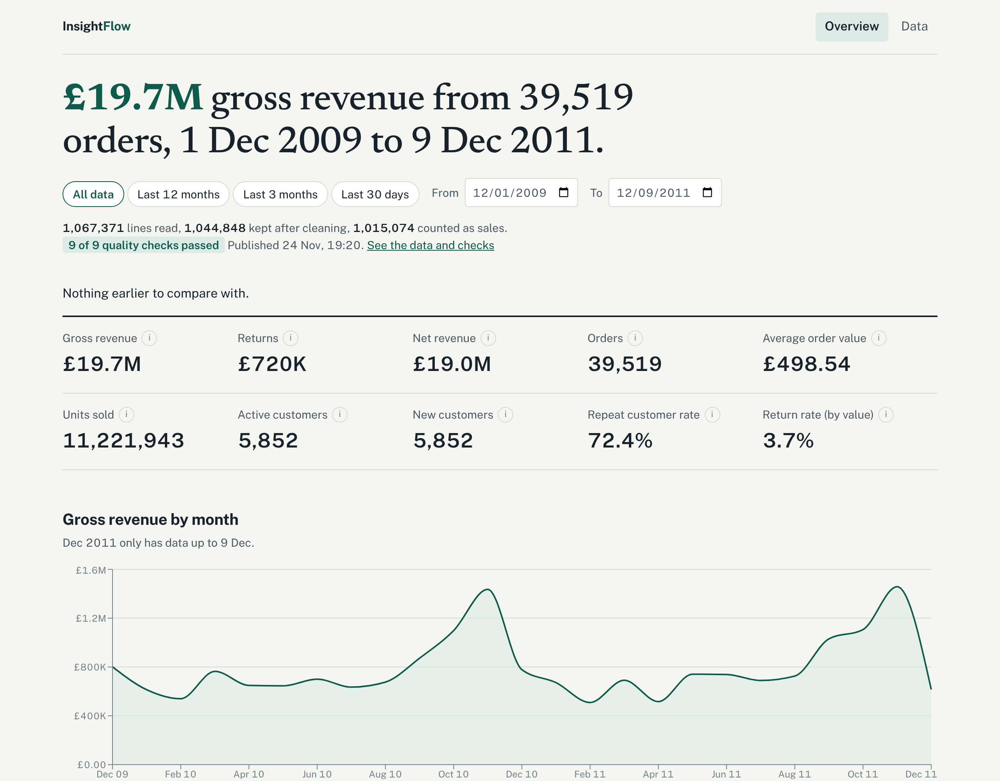

# InsightFlow

A modular Data & AI intelligence platform: ingest business data, process it through a governed
Bronze → Silver → Gold pipeline with data-quality gates, explore deterministic metrics on a dashboard,
ask questions in plain English (answered with visible, validated SQL), and query your documents with
cited answers. First domain: e-commerce analytics.

> **Status:** M2 — data pipeline, quality gates, metric registry, metrics API and React dashboard work
> and are tested. AI features (plain-English questions, document assistant) are next. MVP, **not**
> production-ready, **no authentication**: run on localhost only. See [docs/STATUS.md](docs/STATUS.md).



## Quickstart (Windows 11, PowerShell)
Prerequisites: [uv](https://docs.astral.sh/uv/) (installs Python 3.12 itself), Node.js 22, git.

```powershell
git clone https://github.com/AnuragDube/InsigthFlow.git
cd InsigthFlow
uv sync                                         # backend dependencies (pinned)
uv run pytest                                   # backend tests
uv run python scripts/fetch_sample_data.py      # UCI sample: ~45 MB download, ~1 min
cd frontend; npm ci; npm test; npm run build; cd ..
$env:INSIGHTFLOW_FRONTEND_DIST = "frontend/dist"
uv run uvicorn insightflow.api.app:create_app --factory --host 127.0.0.1 --port 8000
```

Open http://127.0.0.1:8000 and choose **Load sample data**. The first run takes a few seconds.
Use **Data → New dataset** to keep later uploads separate from the sample dashboard. For an
offline rehearsal with deterministic results, see [the fixture walkthrough](docs/STATUS.md#offline-rehearsal-setup).
Use **Ask** for supported questions such as “How much did we sell?” or a dashboard metric name.
Each answer includes its applied dates, published run, and parameterized SQL. This works offline.
Use **Documents** to upload small UTF-8 text or Markdown files and search for excerpts with
source line numbers. Document search also works offline.
Use **Forecast** on a published dataset with at least 35 calendar days to compare two
seven-day gross-revenue forecasts and their historical mean absolute errors.
Use **Customers** to compare four segments based on when known customers last bought,
how often they ordered, and how much they spent in the published sales window.
Use **Display currency** on a monetary report to switch between GBP, USD, EUR, and INR.
For currencies other than GBP, enter a manual rate per pound. The browser applies that
rate to displayed amounts across all dates. Published values and API responses stay in GBP.

For frontend development with hot reload, run the API as above and `npm run dev` in `frontend/`
(http://localhost:5173, proxies `/api`). End-to-end tests: `npm run e2e` in `frontend/`.

Quality gate before committing (Git Bash / Linux / macOS): `scripts/check.sh`.

## Documentation
| Doc | Contents |
|---|---|
| [Status](docs/STATUS.md) | Current phase, pending decisions, blockers — start here |
| [Data profile](docs/DATA_PROFILE.md) | Real-data findings and measured pipeline run |
| [PRD](docs/PRD.md) | Vision, users, journeys, P0/P1/P2 scope, requirements |
| [Architecture](docs/ARCHITECTURE.md) | Modules, technology selection, API design, AI architecture |
| [Data architecture](docs/DATA_ARCHITECTURE.md) | Medallion design, storage layout, metrics, quality, metadata schema |
| [Security](docs/SECURITY.md) | Threat model, SQL sandbox, prompt injection, tenant isolation |
| [Deployment](docs/DEPLOYMENT.md) | Free-tier research, environments, what cannot be free |
| [Roadmap](docs/ROADMAP.md) | Repo structure, roadmaps, test strategy, risks, definition of done |
| [Decisions](docs/decisions/README.md) | Architecture decision records |

## Constraints
₹0 budget · no paid APIs or local LLMs · runs on Windows 11 / 16 GB RAM without Docker, Java or Spark.
